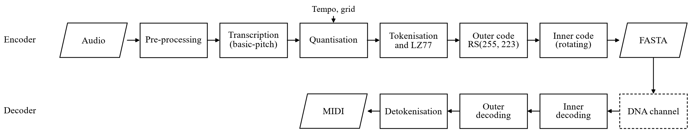

# MP3-to-DNA

[](https://github.com/pejuangvscode/MP3-to-DNA/actions/workflows/tests.yml)


A codec that stores music recordings in synthetic DNA by way of automatic music transcription. Instead of mapping the bytes of an audio file to nucleotides, it transcribes the recording into notes, encodes them as compact feature tokens with repeated phrases replaced by back-references, and maps the tokens to oligonucleotides that satisfy the GC-content and homopolymer constraints of DNA synthesis.

DNA storage is priced per synthesised nucleotide, and compressed audio is already close to its entropy, so the only way to write fewer bases is to change the representation. On 1,211 held-out samples from 120 Slakh songs, covering every pitched instrument class, the codec needed 87.4% fewer bases than encoding the transcribed MIDI file, while the DNA layer itself was lossless.

This repository accompanies an undergraduate thesis in Informatics at Universitas Pelita Harapan.



## How it works

| Stage | What it does | Lossless |
|---|---|---|
| Pre-processing | Decodes MP3 or FLAC, downmixes to mono, resamples to 22.05 kHz | no |
| Transcription | [basic-pitch](https://github.com/spotify/basic-pitch), onset threshold calibrated on a development split, 60 ms minimum note | no |
| Quantisation | Snaps notes to a 1/4, 1/8, 1/16 or 1/24 grid at a per-piece tempo; also writes MusicXML | no |
| Tokenisation | 22-bit note tokens with delta-coded onsets; LZ77 at token level replaces repeats with 17-bit references | yes |
| Outer code | Reed–Solomon RS(255, 223) over GF(2⁸) | yes |
| Inner code | 128-bit blocks to 81 trits, rotating code (no repeated base), SHA-256 scrambling with GC screening | yes |
| Output | 202-nt oligonucleotides (20-nt primers, 162-nt payload) written as FASTA | yes |

Decoding runs the lossless stages in reverse and writes MIDI and MusicXML. The design caps the effective density at 1.004 bits per base.

## Results

Test split: 1,211 samples from 120 Slakh songs (every pitched stem, 12 instrument classes), 45.4 h of notated music, 447,814 reference notes. Stems whose tempo changes are cut into one sample per tempo. Statistics treat the song as the unit, since stems of one song are not independent.

| Measure | Result |
|---|---|
| Token round trip | Bit-identical for all 1,211 samples |
| Constraint compliance | All 39,237 oligonucleotides within 40–60% GC (41.6–59.4%); longest homopolymer 2 |
| Bases for the whole split | 7,925,874 |
| Saving against the transcribed MIDI file | 87.4% |
| Saving from repeat detection alone | 33.1 ± 24.3% of tokens per sample (29.7% of bases) |
| Mean effective density | 0.777 bits per base (best sample 1.003) |
| Note-level F-measure (50 ms onset, 50 cents) | 0.554 per sample, 0.544 per song |
| Octave-tolerant F-measure (one shift of 0, ±12 or ±24 semitones per sample) | 0.615 per sample, 0.610 per song |

Reconstruction error is dominated by transcription, and accuracy depends mostly on the instrument: median F-measure per song ranges from 0.79 for piano to 0.13 for synth lead. Part of the low scores is an octave mismatch rather than a transcription failure: 52 samples score below 0.1 strictly but at least 0.4 once shifted by an octave, mostly synth lead, brass, bass and guitar. Quantisation raises F-measure slightly but significantly (+0.032 per song, 95 of 120 songs). The gain comes from instruments with soft attacks: transcribed onsets of string ensembles, reeds and pipes lag the grid by 32–38 ms, and rounding to the grid removes that lag, while on piano and guitar quantisation lowers F-measure slightly. Reed–Solomon codeword granularity hides repeat detection on short payloads: two thirds of the samples with little repetition save no bases from it.

## Installation

Developed and tested with Python 3.11. Transcription runs on the CPU, so no GPU is needed.

```bash
git clone https://github.com/pejuangvscode/MP3-to-DNA.git
cd MP3-to-DNA
pip install -r requirements.txt
```

## Usage

The tempo of the recording must be given, since tempo estimation is outside the scope of the codec.

```bash
python -m src.encode --input song.mp3 --tempo 120 --output song.fasta
python -m src.decode --input song.fasta --output song.mid
```

`--grid` selects the rhythmic grid (0 = 1/4, 1 = 1/8, 2 = 1/16, 3 = 1/24; default 2), and `--no-repeat-detection` turns off LZ77. Encoding also writes the transcription as MIDI and the quantised notes as MusicXML into a `work/` folder next to the FASTA file.

## Reproducing the experiments

The corpus manifest [`data/slakh_v3/corpus.csv`](data/slakh_v3/corpus.csv) lists every sample with its source track, instrument class, tempo, grid, split and tercile labels. The audio is not in the repository; it is fetched from a Kaggle mirror of Slakh2100, which needs Kaggle credentials.

```bash
pip install kagglehub pyyaml
python scripts/fetch_slakh_subset.py --out new_dataset/slakh_subset --n 151
python -m src.slakh --source new_dataset/slakh_subset --out data/slakh_v3
python -m src.calibrate --data-dir data/slakh_v3 --split dev --output results/calibration_v3
python -m src.experiment --data-dir data/slakh_v3 --split test --onset-threshold 0.7 --output results/slakh_test_v3
python -m src.octave --data-dir data/slakh_v3 --split test --run results/slakh_test_v3
python -m src.characterize --data-dir data/slakh_v3 --split test --output results/characterization_v3
python -m src.analysis --data-dir data/slakh_v3 --run results/slakh_test_v3 --characterization results/characterization_v3/per_sample.csv --output results/analysis_v3
python -m src.ablation --data-dir data/slakh_v3 --split test --work-dir results/slakh_test_v3/work --onset-threshold 0.7 --output results/ablation_v3 --transcribe
```

The steps are, in order:

1. Preparing the corpus: cutting stems at tempo changes, per-piece tempo and grid fitting, cutting at long rests, dropping samples whose reference notes the audio does not play, and the development/test split.
2. Calibrating the onset threshold on the development split only.
3. Running the codec on the test split.
4. Rescoring it with an octave-tolerant F-measure, since some Slakh patches sound an octave away from their MIDI.
5. Characterising the corpus.
6. Running the statistical tests.
7. Running the ablation study.

Transcriptions are cached by the decoded audio, so an interrupted run picks up where it stopped. `--keep-splits` on `src.slakh` keeps the split of every song an earlier manifest already placed, so growing the corpus leaves the calibration set where it was.

## Repository layout

```
src/
  preprocess.py    audio loading, mono downmix, resampling
  transcribe.py    basic-pitch inference with an on-disk cache
  quantize.py      grid quantisation
  notation.py      MusicXML export
  tokenizer.py     token scheme, token-level LZ77, bit packing
  dna_codec.py     Reed-Solomon, scrambling, rotating code, FASTA
  encode.py        audio to FASTA
  decode.py        FASTA to MIDI and MusicXML
  reconstruct.py   quantised notes to MIDI
  evaluate.py      efficiency, compliance, accuracy, error decomposition
  baselines.py     comparison paths (audio bytes, transcribed MIDI, 2 bits per base)
  slakh.py         corpus preparation from Slakh
  corpus.py        manifest loading and validation
  characterize.py  quantitative corpus characterisation
  calibrate.py     onset-threshold calibration
  experiment.py    full evaluation run
  octave.py        octave-tolerant rescoring of a finished run
  analysis.py      statistical tests over a finished run
  ablation.py      ablation study
  config.py        every design constant, in one place
tests/             unit tests
scripts/           dataset download
assets/            README images
data/slakh_v3/     corpus manifest
```

## Tests

```bash
pytest -m "not slow"
pytest
```

The first command skips the tests that run the transcription model; the second runs everything.

## Citation

If you use this code, please cite it as described in [`CITATION.cff`](CITATION.cff), or use the "Cite this repository" button on GitHub.

## Acknowledgements

The evaluation uses [Slakh2100](http://www.slakh.com) (Manilow et al., WASPAA 2019), and transcription uses Spotify's [basic-pitch](https://github.com/spotify/basic-pitch) (Bittner et al., ICASSP 2022). Error correction relies on [reedsolo](https://github.com/tomerfiliba-org/reedsolomon), evaluation on [mir_eval](https://github.com/mir-evaluation/mir_eval), MusicXML export on [music21](https://github.com/cuthbertLab/music21), and FASTA output on [Biopython](https://biopython.org).

## License

See [LICENSE](LICENSE).
